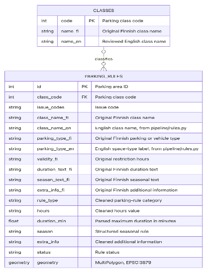
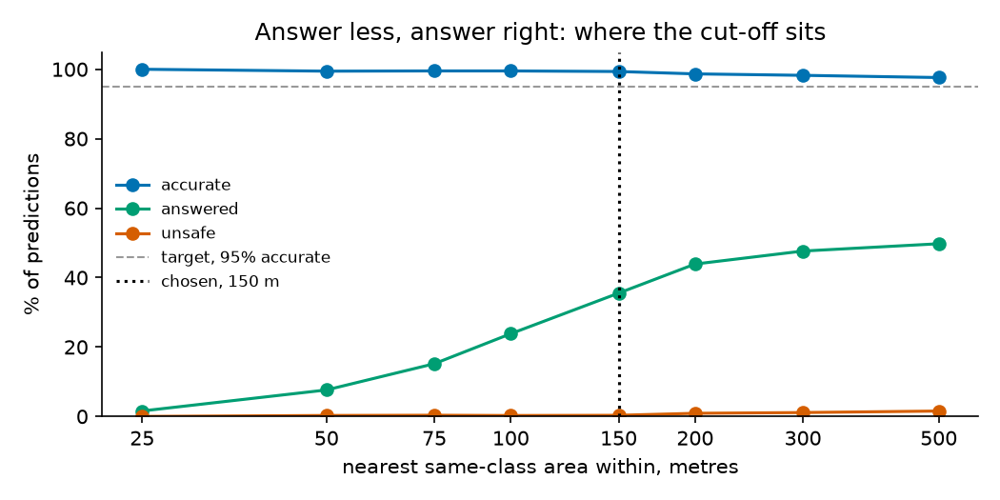

# Parkkiko: make your parking life easier!

*Technical report  |  Jamila Shulekha, Mai Phuong Pham, Ömer Furkan Tercan*

**App:** https://parkkiko.app  **Repository:** https://github.com/tercanfurkan/parkkiko

# Introduction

Have you ever been in your car, driving around while you try to find a parking spot, only to realise you might have missed the sign or it is shown in the other direction? There’s no need to worry anymore, because Parkkiko helps you with finding the perfect parking spot for you.

Parkkiko is a mobile-friendly web application that uses your location (with permission, of course!) to show the street parking around you. When you are driving your car, it may be so that you see a free spot and want to park there, but the signs explain the duration you are allowed to park, whether you have to pay, and the hours within which free parking is allowed. Parkkiko informs you about the place you tap on the map: whether you may park there, whether you pay, and until when. It also has a built-in alarm that reminds you ten minutes before your parking period expires so you do not have to face fines, of which Helsinki recorded 156,383 in 2023 (City of Helsinki, *Pysäköintivirheet Helsingissä*, CC BY 4.0). Our target user is a driver in central Helsinki without a residential permit, especially a visitor or an occasional driver.

We managed to find open data from the City of Helsinki, a map of all the street parking divided into sections, which show if an area has free or paid parking, the maximum duration of free parking, if it is prohibited to park somewhere after certain hours of the day, et cetera. That data is incomplete or self-contradicting for about one section in seven, so the project's central rule is that the app never answers more confidently than the data supports: where the city is silent, it says *check the sign*, or gives an estimate labelled as one. Each stage below is walked through, with its code, in a notebook in `notebooks/stages/`, and every number is generated by `analysis/report_stats.py`.

# Data collection

The primary source is the [City of Helsinki Web Feature Service (WFS)](https://kartta.hel.fi/avoindata/dokumentit/Aineistolista_wms_avoindata.html), which contains 8,754 parking-area polygons, and avoindata:Piirijako\_peruspiiri, which supplies 34 basic districts. The pipeline requests metric coordinates (EPSG:3879), downloads paginated GeoJSON, and saves the server responses under data/raw/YYYY-MM-DD/. The data is published under CC BY 4.0 and does not require a login or API key. The processed snapshot is committed, so the team, the report and the app share one copy.

The holiday calendar is generated from the Python holidays package and exported as a small JSON file so the browser can apply holiday-specific parking windows without running Python. The calendar covers three years from generation; holidays and the preceding days can use different sign windows, and Christmas Eve and Midsummer Eve are flagged as uncertain parking holidays.

One early bug taught us to check data rather than trust its label: a saved file silently lost its coordinate system, and a spatial join matched nothing without raising an error. We also evaluated the city's live roadworks data and dropped it, because the arrangements last for years and rarely close parking spaces.

# Preprocessing

The main preprocessing task is to turn human-readable rules into fields the application can evaluate. pipeline/rules.py maps the city’s parking class and space type into paid, free\_limited, banned\_hours, always\_banned, reserved, or unknown. Space type can override the class: for example, a taxi bay is reserved even if its class would otherwise suggest paid parking. Unknown classes or space types become unknown rather than being assigned a plausible but unsupported label.

Dedicated parsers normalize opening hours, durations, and seasons; the hours field alone has 66 distinct spellings and the time limit 25. For example, 9-21, (9-18) becomes Monday-Friday 09:00-21:00 and Saturday 09:00-18:00; the bracket convention and a third unbracketed range are used to identify weekend windows. The strings 4 h, 4h, 4 H and 4 are normalized to 240 minutes when they occur in the duration field; explicit “no time limit” is represented as zero, while an absent value remains missing. Seasonal date ranges are parsed into start and end dates. Plain sign-reference codes, such as 7539 or C41, are retained as metadata, while prose conditions the parser cannot interpret are preserved for display to the driver. The most important design choice is fail-closed parsing. A parser must account for the entire field rather than silently accepting a recognizable substring. Thus 7-18 7-15 is ambiguous, and max 60 min lauantai is unreadable because the weekday condition would otherwise be lost.

Each parking area receives a status, machine-readable issue code and plain-language reason. official means a complete rule was parsed; missing\_hours means the rule type is known but hours are absent for a rule that needs them; uncertain means the data is unreadable, ambiguous, or inconsistent. This distinction avoids treating missing data as a parsing error, or turning contradictory data into confident guidance. In the end, 7,537 areas have a complete rule, 978 lack the hours, and 239 are uncertain, mostly because of conditions written in free text.

Geospatial validation is equally important. The pipeline checks that identifiers are present and unique, geometries are non-empty polygons, and coordinate magnitudes are plausible for metric Helsinki coordinates. A GeoJSON file conventionally declares WGS84 even if its coordinates are actually metric; the pipeline explicitly assigns EPSG:3879 on read, checks the bounds, and converts to WGS84 only for the web export. District membership is assigned using each polygon’s centroid, avoiding dependence on row order for areas crossing boundaries. The web export keeps only fields the app needs, rounds coordinates to five decimals, and omits empty or null properties so absence has a consistent meaning.

We design the data model and add standardized rule fields and labels in English to easily manage and explore the data (Figure A1).

# Exploratory analysis

We started from summary statistics. The typical area is paid on weekdays 9-21 and on Saturdays 9-18, and three quarters of street parking allows parking in some form. In the remaining quarter an ordinary driver may not park at all: bans, and bays reserved for others, mostly e-scooters, electric cars and taxis.

The register is concentrated in the city centre, and rule types cluster by district: the centre is paid, while some neighbourhoods use parking discs (Figure A2). Crossing fields found errors in the register, such as bans with a time limit, and outlier analysis found large no-parking squares lying over street sections, which changed how the app draws the map. The areas without hours sit mostly just outside the centre (Table B3).

The key finding chose the learning method. Copying an area's hours from its nearest neighbour of the same class is almost always right when that neighbour is close, but accuracy falls quickly with distance (Figure A3), and most areas we need to predict are far from one. A headline accuracy measured on easy cases would therefore overstate what a model can do.

# Learning task

The learning task predicts the hours for the 978 areas without them, as supervised classification learnt from 5,661 areas with a complete rule. The model is a k-nearest-neighbour vote among nearby areas of the same parking class. We tested it at the distances it would really face, and by holding out whole districts. Besides accuracy, we measured how often an answer is unsafe: saying parking is free when the driver would in fact have to pay or move. Used everywhere, the model is right 62% of the time and unsafe in about a quarter of cases, better than the baselines but far from usable (Table B1).

So we let the model abstain. Before seeing any results we fixed a bar: at least 95% accurate and under 1% unsafe. Answering only where the five nearest neighbours lie within 150 m and all agree meets it on data it was not tuned on, at 99.4% accurate and 0.3% unsafe (Figure A4). The app shows **333** such estimates, labelled as estimates, and the rest still say *check the sign*. The gain is uneven: it goes mostly to districts near the centre (Tables B2 and B3).

# The app and communication of results

The result is a mobile web map at parkkiko.app with no install, no account and no server: the data ships with the page and every rule is evaluated in the browser, so nothing about the driver leaves the phone. Street sections are coloured by what the driver may do there, and sections with incomplete data are drawn faded. Tapping one gives a plain answer, such as "Paid parking until 21:00. Free after that until 09:00 tomorrow", including when to set a parking disc (Figure A5). Where the data cannot support an answer, the app says *check the sign* and why, and estimates carry a label and the advice to trust the sign if it differs. A reminder can be added to the phone's calendar. Automated tests check the answer for every area in the shipped data.

# Reflection and future work

**What worked.** Measuring before deciding: exploration chose the learning method and showed in advance where it would fail, and letting the model abstain turned a weak model into a safe one.

**What did not, and why.** The model estimates hours for only about a third of the areas that lack them; the largest group, free short-term parking, has too few examples nearby. Choosing the side of the street, fine amounts and suggestions of nearby spots were not built, because we put the time into making the basic answer right.

**What changed from the plan.** We dropped the planned roadworks data after measuring it, and the fines data became background rather than an input, because it records no time of day. The answer also changed: rather than when today's rule ends, it says when the rule next changes, since a ban that ends in the evening returns in the morning.

**What we would do differently.** Profile every field and check every file before building on it, and make parsers refuse what they cannot read from the start: our costliest bugs came from trusting data or code that looked right.

**Future steps.** Traffic sign data from the national Digiroad database could serve as a second source, to check the register, add training data, and tell the two sides of a street apart. Unused register fields could serve permit holders and measure coverage per parking space. For now, due to using the data from the City of Helsinki, the app only covers Helsinki; since the pipeline reads a standard open-data format, developers could expand it to Uusimaa or even all of Finland wherever cities publish their registers the same way.

# Learning outcomes

Each stage taught us one thing: in data collection, to check data rather than trust its label; in preprocessing, that refusing to guess beats a partial answer; in exploration, that the analysis should choose the method and show its limits; in learning, that how a model is tested, and which errors count as costly, matters more than the model itself; and in the app, that what users see can be tested like code. Technically, we learned geospatial processing with GeoPandas, nearest-neighbour methods, cross-validation, and building a small web app on open data.

*Jamila Shulekha: one line on what you took from the project.*

*Mai Phuong Pham: one line on what you took from the project.*

*Ömer Furkan Tercan: one line on what you took from the project.*

\newpage

# Appendix A. Figures

**Figure A1.** The data model: the cleaned rule fields beside the city's original ones.

**Figure A2.** Rule types per district, sorted by the number of areas.

**Figure A3.** Hours copied from the nearest same-class area, correct by distance, against always
guessing the most common pattern.

**Figure A4.** Choosing the cut-off. As the distance limit loosens, how often a shown estimate is
wrong or unsafe (top), against the limits fixed beforehand, and how many of the 978 areas get one
(bottom). On the simulation rounds the cut-off was chosen on.

**Figure A5.** *To add: two screenshots of the panel, an ordinary answer and an estimate.*

# Appendix B. Tables

Generated by `analysis/report_stats.py`, copied from `docs/report_stats.md`.

**Table B1.** Predicting the missing hours at the distances they really face, against two baselines.

| Method                                            |   Accuracy % |   Macro F1 |   Unsafe % |
|:--------------------------------------------------|-------------:|-----------:|-----------:|
| Always the most common pattern                    |         28.3 |      0.012 |       43   |
| Always the most common pattern of the class       |         48.1 |      0.047 |       26.6 |
| Nearest neighbours, k=1                           |         60.7 |      0.207 |       22.7 |
| Nearest neighbours, k=3                           |         61.7 |      0.205 |       23.3 |
| Nearest neighbours, k=5                           |         61.8 |      0.186 |       24.2 |
| Nearest neighbours, k=5, whole districts held out |         63.8 |      0.105 |       13.6 |

**Table B2.** Who the cut-off answers, and who the app shows, by parking class.

|   Class |   To predict |   Answered |   Shown in the app |   Accuracy % without cut-off |   Accuracy % with |   Unsafe % with |   Simulated answers |
|--------:|-------------:|-----------:|-------------------:|-----------------------------:|------------------:|----------------:|--------------------:|
|       1 |          353 |          1 |                  0 |                         11.4 |              81.8 |            18.2 |                  11 |
|       2 |           18 |          0 |                  0 |                              |                   |                 |                   0 |
|       4 |            3 |          3 |                  3 |                         96.7 |             100   |             0   |                  29 |
|       5 |           56 |         29 |                  0 |                         85.7 |              98.5 |             1   |                 201 |
|       6 |          437 |        314 |                314 |                         96.2 |              99.5 |             0.2 |                2970 |
|       7 |           29 |         10 |                  0 |                         82.8 |              98.5 |             1.5 |                  68 |
|       8 |           10 |         10 |                 10 |                        100   |             100   |             0   |                  96 |
|       9 |           36 |          4 |                  4 |                         45.6 |             100   |             0   |                  18 |
|      10 |           36 |          2 |                  2 |                         83.6 |             100   |             0   |                  16 |

**Table B3.** Areas with a rule the app can answer, by district, before and after prediction.

| District      |   Areas |   Without hours |   Answered before |   Gained |   Before % |   After % |
|:--------------|--------:|----------------:|------------------:|---------:|-----------:|----------:|
| REIJOLA       |     597 |             330 |               264 |       53 |       44.2 |      53.1 |
| VALLILA       |     569 |             294 |               264 |      211 |       46.4 |      83.5 |
| ALPPIHARJU    |     305 |             117 |               184 |       37 |       60.3 |      72.5 |
| MUNKKINIEMI   |     592 |              75 |               512 |        6 |       86.5 |      87.5 |
| PASILA        |     146 |              61 |                84 |        0 |       57.5 |      57.5 |
| HAAGA         |     504 |              30 |               474 |        0 |       94   |      94   |
| TAKA-TÖÖLÖ    |     554 |              25 |               522 |        1 |       94.2 |      94.4 |
| ULLANLINNA    |    1330 |              19 |              1296 |       11 |       97.4 |      98.3 |
| LAUTTASAARI   |     790 |               8 |               779 |        4 |       98.6 |      99.1 |
| VIRONNIEMI    |     795 |               7 |               768 |        3 |       96.6 |      97   |
| KALLIO        |    1009 |               6 |               946 |        6 |       93.8 |      94.4 |
| KAMPINMALMI   |    1471 |               5 |              1354 |        1 |       92   |      92.1 |
| VANHAKAUPUNKI |      48 |               1 |                46 |        0 |       95.8 |      95.8 |
