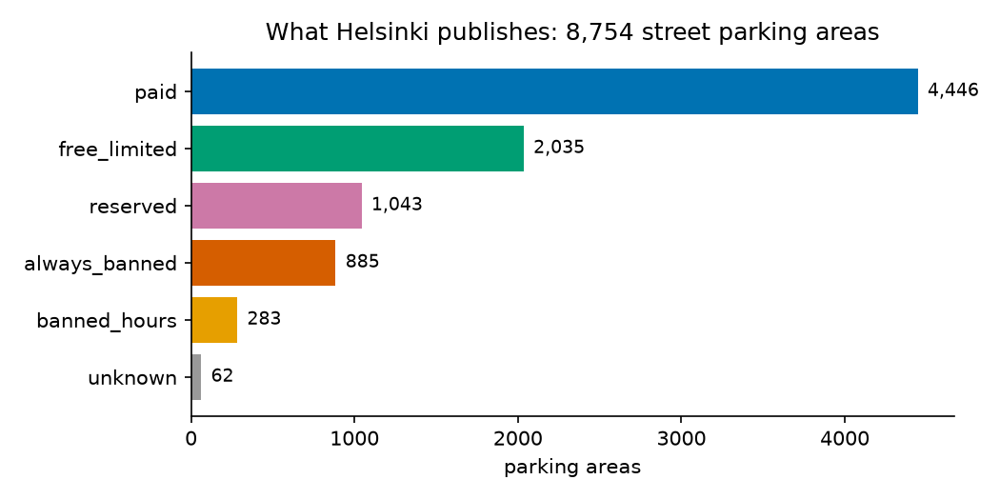
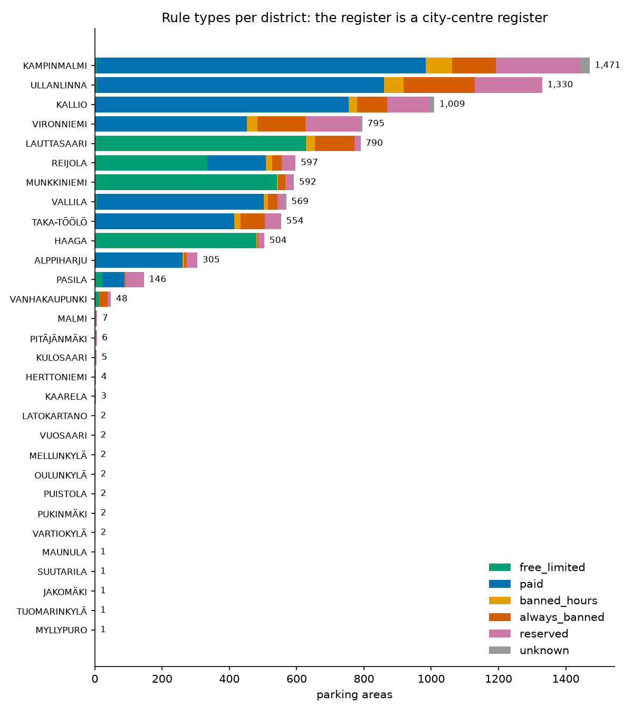
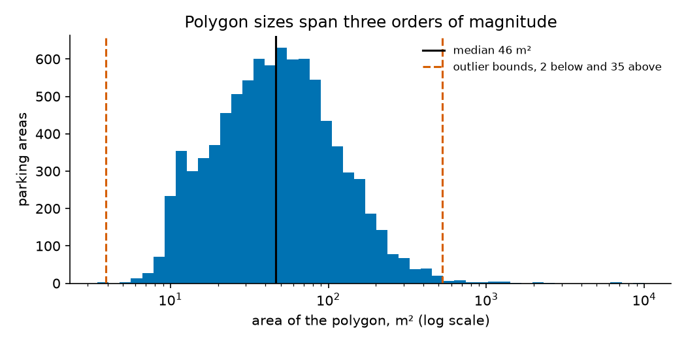
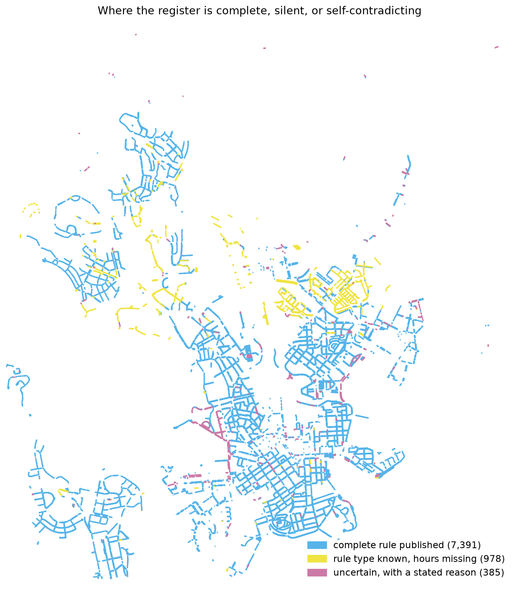
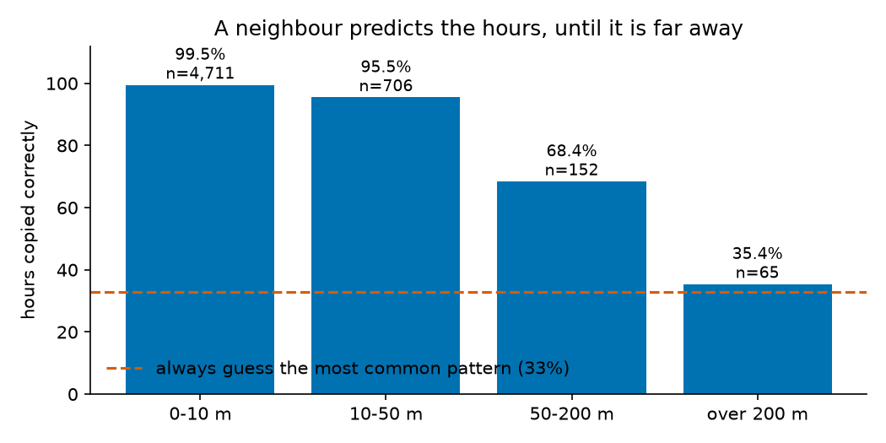

<!--
Maintained draft of the technical report. Updated as each stage closes; a section still marked
"To be written" is a stage that has not closed yet.

- What the report must be, and how it is graded: report-spec.md. At most 5 pages as a PDF.
- The body states each finding where it is discussed and points at the appendix for the figure or
  table behind it. Small numbers stay inline; figures and tables of more than a few rows go to the
  appendix.
- Every number comes from report_stats.md, which analysis/report_stats.py generates. Appendix B
  tables are copied verbatim from it: after rerunning with --write --figures, copy them again.
  One-off measurements (the fines count, the rejected datasets, the traffic signs) are sourced
  where they appear.
- Comments like this one do not render in the PDF.

Status: stages 1-4 written, 5-6 and the reflection to come.
-->

# Parkkiko: technical report

Jamila Shulekha, Mai Phuong Pham, Ömer Furkan Tercan. Introduction to Data Science, University of
Helsinki, autumn 2026. App: https://tercanfurkan.github.io/parkkiko/. Code and data:
https://github.com/tercanfurkan/parkkiko.

**Summary.** Helsinki publishes every street parking rule as open data, but as codes and strings
no driver can read at the kerb. Parkkiko turns that register into one plain answer for a chosen
street section at the current moment: may I park here, do I pay, and until when. The register is
incomplete or self-contradicting for about one section in six, and the project's central rule is
that the app never answers more confidently than the data supports. Most of the technical work
went into knowing when not to answer.

## 1. Problem and target user

On the street a parking rule is invisible. It depends on the day, the hour and the side of the
road, and the sign that states it may be behind the driver. The city recorded 156,383 parking
fines and 9,341 warnings in 2023 (City of Helsinki, *Pysäköintivirheet Helsingissä*, Helsinki
Region Infoshare, CC BY 4.0). Our target user is a driver in central Helsinki without a residential
permit, especially a visitor or an occasional driver, and the change we aim for is from "I think
this is fine" to "paid until 21:00, then free until 09:00 tomorrow", or an honest "check the
sign".

## 2. Data collection

The rules come from the City of Helsinki's open parking register, the WFS layer
`avoindata:Pysakointipaikat_alue`: 8,754 street parking areas, each a polygon with a class, a space
type and the hours, time limit and season written as text. Two sources support it: the city's 34
basic districts (`avoindata:Piirijako_peruspiiri`), used to measure coverage and to split data for
validation, and the Finnish public holidays from the `holidays` package, since a holiday follows
Sunday rules. All are CC BY 4.0 and need no key. `pipeline/fetch.py` saves a dated snapshot and
everything downstream runs on it, so every result is reproducible.

The canvas also planned to use live roadworks. Measured, the city's temporary traffic arrangements
run a median of 711 days, and of the 191 parking areas overlapping one, only 18 state a purpose
that mentions parking. An overlap told us a permit exists nearby, not that the spaces are gone, so
we dropped the source rather than include it because it existed.

## 3. Preprocessing

The register states rules as human text, and turning that into something a program can evaluate
against a date and time was most of the work. `9-21, (9-18)` means Monday to Friday 9 to 21 and
Saturday 9 to 18: brackets mean Saturday and a third range Sunday. The hours field has 66 distinct
spellings, including a `.` typed for a `-`, and the time limit 25 spellings of about eight values,
from `4 h`, `4h` and `4 H` to inline Russian and two ways of writing "no limit" (Table B1). The
rule type comes from the class and the space type together, because the class alone is
ambiguous: class 0 holds both parking bans and reserved bays.

The parsers fail closed: each must account for every character of a field. Earlier versions
returned a confident answer for the part they recognised, so `7-18 7-15` became `7-18`, and
`max 60 min lauantai` became 60 minutes with the Saturday condition silently dropped. Now both are
flagged. Every area ends with a status, an issue code a program can branch on, and a reason in
plain words for the driver. Of the 385 areas that end up uncertain, 301 carry a free-text
condition we do not parse, 86 an unreadable field and one genuinely ambiguous hours.

> *To add: the before-and-after table of parser output (board task R4).*

## 4. Exploration

We carried out every view the canvas's exploration box planned, and two of them found things we
had not been looking for. The stage is walked through, with the code behind each finding, in
`notebooks/04_exploration.ipynb`.

Following the course's practice of describing the typical case before plotting anything, we took
the mode of each category and the median of each number (Table B2). The typical area is paid,
Monday to Friday 9-21 and Saturday 9-18, has a four-hour limit where one is stated, covers 46 m²
and lies in Kampinmalmi, in the centre. That hours pattern covers 32.9% of the areas with stated
hours, which is also the score the learning task's dummy baseline will get. Three quarters of
street parking allows parking in some form (Figure A1). The remaining quarter, reserved and
banned, is where fines happen and is exactly what a driver cannot see from the car: reserved bays
look ordinary, and the largest groups are for e-scooters, electric cars, taxis and loading
(Table B3).

The register is a city-centre register (Figure A2). Kampinmalmi, Ullanlinna and Kallio alone hold
1,471, 1,330 and 1,009 areas, while 17 of the 30 districts with any area have fewer than ten. The
likely reason is that the city does not regulate kerbside parking in the suburbs, so an empty map
there probably means "no rule" rather than "no data", but nothing in the register lets the app
tell a driver which. The same figure shows rule type clustering by district: the centre is paid,
while Lauttasaari, Munkkiniemi and Haaga are almost entirely free with a time limit, the
parking-disc districts. That matters for the learning task, because holding out a whole district
in validation also holds out a whole rule regime.

Crossing the time limit with the rule type (Table B4) shows limits where they should be, four
hours on free-limited areas and one or four hours on paid ones, and also surfaces register errors
no single-column check would find: two areas typed "always banned" and one of unknown type carry a
four-hour limit.

Polygon sizes span three orders of magnitude (Figure A3), so we found outliers with the
interquartile rule on the logarithm of the area: on the raw scale every large polygon would be an
outlier and no small one could be. Two areas fall below 3.9 m² and 35 above 527 m² (Table B5). The
largest are not street sections but whole no-parking squares, up to 9,977 m², and 13 of the 35
large polygons overlap other areas, 31 in all. That is a finding for the app rather than the
analysis: where a no-parking zone lies over a street section, a tap can select the zone instead of
the section the driver meant.

What the app can answer follows from the parsing. The register states a complete rule for 7,391
areas, a rule type without hours for 978, and something unreadable or self-contradicting for 385.
The gaps are not spread evenly but sit mostly outside the centre (Figure A4).

The last finding chose the learning method. Hiding each area's hours and copying them from its
nearest neighbour of the same class is correct 97.5% of the time, against the 32.9% baseline
(Figure A5). Accuracy depends almost entirely on distance, from 99.5% within 10 m to 35.4% beyond
200 m (Table B6), and the 978 areas we actually need to predict sit a median of 153 m from the
nearest area we can learn from, only 17.7% of them within 50 m. The headline number therefore
describes areas we do not need to predict: exploration chose the method and also set an honest
expectation for it.

## 5. Learning

> *To be written when the stage closes. Must cover: the problem as supervised classification of
> the hours pattern; the dummy baseline; same-class k-nearest neighbours; spatially blocked
> validation by district; the distance-matched test and the accuracy it gives; the cut-off chosen
> from accuracy against coverage, favouring accuracy; error analysis; what imputation changes for
> a driver.*

## 6. The app and communication of results

> *To be written when the stage closes. Shipped so far: a static map site (Vite, React, Leaflet,
> no backend, about 0.4 MB of data compressed); the answer line, which evaluates a rule at the
> current moment through the holiday calendar and runs it to the next change rather than to the
> end of today's window; a live countdown; a reminder ten minutes before the deadline as a
> calendar alarm plus a notification. Cover: why the answer runs to the next change (a ban that
> ends at 18:00 starts again at 07:00), colour-blind safe colours, and how "check the sign" is
> shown.*

## 7. Reflection on the canvas

**What worked.** Measuring before choosing: the neighbour experiment chose the learning method
and told us in advance how far its accuracy would carry. The exploration plan also held as
written, and two of its views found what we had not looked for, the register errors and the
overlapping polygons.

**What changed from the plan, and why.** Live roadworks were dropped once measured. The fines data
moved from motivation to stretch goal, because the 2023 records carry only a month and a year, so
the planned link to time of day or weather was impossible; street-level density is the part that
remains buildable. And the answer changed shape. The canvas promised "paid until 21:00, then
free", but working through real rules showed that a window ending is not the rule ending: a car
left after a ban ends at 18:00 is fined at 07:00 the next morning, so the answer now runs to the
next time the rule changes.

> *To add when stages 5 and 6 close: whether predicted hours reached the app, and the
> side-of-the-street selection.*

**What we would do differently.** We caused ourselves a coordinate system bug: a GeoJSON file always
declares itself WGS84 even when it holds metric coordinates, so our metric file was read as
degrees. Nothing crashed; a spatial join simply matched zero rows, and we noticed only because
zero was implausible. We would also check a dataset before trusting its name, since "temporary"
traffic arrangements last years, and make the parsers fail closed from the first version: ours
first silently truncated what they did not understand, which in an app about honesty is the worst
failure available.

## 8. Future steps

> *To be written. Candidates, each measured in `docs/future-work.md`: traffic signs from Digiroad
> as a second source (14,386 parking signs in Helsinki, as points with a facing direction and
> typed time panels, measured 14 Oct 2026 from `digiroad:dr_liikennemerkit`), street-level fine
> density, and other cities with open parking registers.*

## 9. Learning outcomes

> *To be written by each of us.*

---

## Appendix A. Figures

**Figure A1.** Areas by rule type.

**Figure A2.** Rule types per district, sorted by the number of areas.

**Figure A3.** Polygon sizes on a log scale, with the median and the outlier bounds.

**Figure A4.** Where the register is complete, silent, or self-contradicting.

**Figure A5.** Hours copied from the nearest same-class area, correct by distance, against always
guessing the most common pattern.

## Appendix B. Tables

Generated by `analysis/report_stats.py`, copied from `docs/report_stats.md`.

**Table B1.** Raw spellings per field, and why areas are uncertain.

| Field                        |   Distinct spellings |   Missing or blank |
|:-----------------------------|---------------------:|-------------------:|
| Hours (`voimassaolo`)        |                   66 |               2922 |
| Time limit (`kesto`)         |                   25 |               6247 |
| Season (`kausi`)             |                   15 |               8274 |
| Space type (`tyyppi`)        |                   25 |               6866 |
| Free-text note (`lisatieto`) |                  201 |               6993 |

| Issue code   |   Areas |
|:-------------|--------:|
| note         |     301 |
| unreadable   |      86 |
| ambiguous    |       1 |

385 uncertain areas, 3 with more than one code.

**Table B2.** Summary statistics: the mode of each category, the median of each number.

| Variable            | Typical value             | Share of stated   |   Distinct |   Missing |
|:--------------------|:--------------------------|:------------------|-----------:|----------:|
| Rule type           | paid                      | 50.8%             |          6 |         0 |
| Status              | official                  | 84.4%             |          3 |         0 |
| Space type          | No parking                | 47.2%             |         20 |      6886 |
| District            | KAMPINMALMI               | 16.8%             |         30 |         0 |
| Hours               | mon_fri 9-21, sat 9-18    | 32.9%             |         51 |      2931 |
| Season              | 1.4.-31.10.               | 82.6%             |          4 |      8731 |
| Time limit, minutes | 240 (middle half 240-240) |                   |            |      5951 |
| Area, m²            | 46 (middle half 25-84)    |                   |            |         0 |

**Table B3.** Reserved areas by space type.

| Reserved for          |   Areas |
|:----------------------|--------:|
| Electric scooter      |     312 |
| Electric car          |     187 |
| Taxi                  |     122 |
| Loading zone          |     100 |
| Accessible parking    |      88 |
| Tourist coach         |      63 |
| not stated            |      60 |
| Diplomatic vehicle    |      59 |
| Motorcycle            |      17 |
| Bicycle               |      14 |
| Taxi, charging        |       8 |
| Car or van            |       3 |
| Official vehicle      |       3 |
| Police                |       2 |
| City Executive Office |       1 |
| Mobile library        |       1 |
| Parklet               |       1 |
| Finnish Government    |       1 |
| Lorry                 |       1 |

**Table B4.** Time limit against rule type.

| Time limit       |   always_banned |   banned_hours |   free_limited |   paid |   reserved |   unknown |
|:-----------------|----------------:|---------------:|---------------:|-------:|-----------:|----------:|
| none stated      |             883 |            281 |            372 |   3372 |        982 |        61 |
| no limit, stated |               0 |              0 |              0 |      0 |          7 |         0 |
| 15 min           |               0 |              0 |              5 |      0 |          5 |         0 |
| 30 min           |               0 |              0 |             16 |      3 |         17 |         0 |
| 1 h              |               0 |              1 |             27 |    457 |         13 |         0 |
| 2 h              |               0 |              1 |             20 |     84 |          6 |         0 |
| 4 h              |               2 |              0 |           1582 |    524 |          1 |         1 |
| 6 h              |               0 |              0 |              0 |      0 |          1 |         0 |
| 12 h             |               0 |              0 |              0 |      0 |          5 |         0 |
| 24 h             |               0 |              0 |             13 |      6 |          6 |         0 |

**Table B5.** Polygon size outliers, and the outlying areas.

| Measure               | Value         |
|:----------------------|:--------------|
| Median area           | 46 m²         |
| Smallest              | 3.5 m²        |
| Largest               | 9,977 m²      |
| Outlier bounds        | 3.9 to 527 m² |
| Below the lower bound | 2             |
| Above the upper bound | 35            |

|    Id | Rule type     | Space type   | District    |   Area, m² |
|------:|:--------------|:-------------|:------------|-----------:|
| 16661 | always_banned | No parking   | LAUTTASAARI |        3.5 |
| 16673 | always_banned | No parking   | LAUTTASAARI |        3.9 |
| 16732 | always_banned | No parking   | TAKA-TÖÖLÖ  |     9977.4 |
| 16606 | always_banned | No parking   | KALLIO      |     7093.6 |
| 16585 | always_banned | No parking   | ULLANLINNA  |     6743.4 |
| 16607 | always_banned | No parking   | KALLIO      |     2549.7 |
| 17035 | always_banned | No parking   | KALLIO      |     2167.1 |

13 of the 35 large outliers overlap another area, 31 areas in all.

**Table B6.** Neighbour accuracy by distance, and how far the areas we must predict are from one.

| Distance to nearest same-class area   |   Correct |   Areas |
|:--------------------------------------|----------:|--------:|
| 0-10 m                                |      99.5 |    4711 |
| 10-50 m                               |      95.5 |     706 |
| 50-200 m                              |      68.4 |     152 |
| over 200 m                            |      35.4 |      65 |

| Measure         | Value   |
|:----------------|:--------|
| Areas measured  | 978     |
| Median distance | 153 m   |
| Within 10 m     | 3.8%    |
| Within 50 m     | 17.7%   |
| Within 200 m    | 57.4%   |
